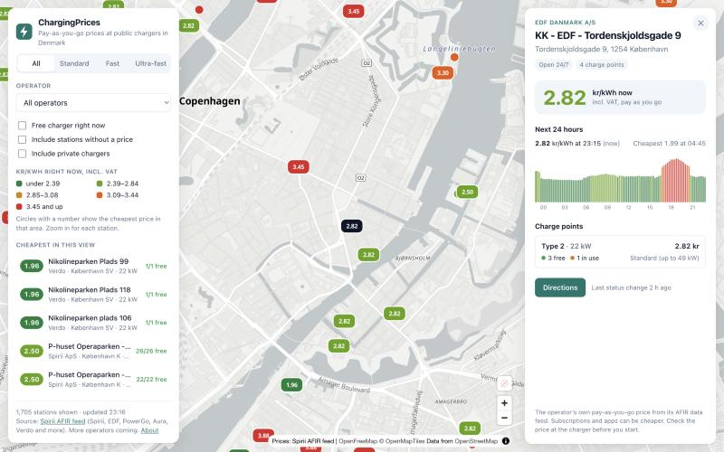

# ChargingPrices

A map of public EV charging stations in Denmark that shows what each one costs per kWh right now.


> **Status:** phase 1 works locally. Live prices for about 2,300 sites from 21 operators, refreshed every 2 minutes. See the [roadmap](#roadmap).



## The problem

Denmark has many charging operators: Clever, OK, Spirii, E.ON, Norlys, Monta, Lidl and more. Each one has its own app and its own prices, and many prices change every 15 minutes. If you pay as you go, without a subscription, there's no simple way to see who is cheapest near you at this moment.

## Why this is possible now

Since 14 April 2026, Article 20 of the EU's Alternative Fuels Infrastructure Regulation (AFIR) has required operators of public chargers to publish their locations, live status and **ad hoc price** through each country's National Access Point. In Denmark that is [Dataudveksleren](https://du-portal-ui.dataudveksler.app.vd.dk/), run by Vejdirektoratet, and the required format is DATEX II.

ChargingPrices reads those feeds, maps them into one common model and shows the result on a map.

## What it does

- A map of Denmark with sites coloured by their current price per kWh, from cheapest (green) to most expensive (red). The colour bands follow today's actual spread of prices.
- Clusters show the cheapest price in their area. From zoom level 11, every site shows its price as a label.
- Filters for charging speed (standard, fast, ultra-fast), operator and "free charger right now".
- A list of the five cheapest stations in the visible part of the map.
- A station panel with the price now, a 24-hour price curve in 15-minute steps, each charge point's connector, power and live status, start fees and parking fees, and a link for directions.
- A mobile layout with collapsible filters and a bottom sheet.

Prices are each operator's ad hoc price: pay as you go, VAT included. Subscriptions such as Clever One or Norlys member discounts can be cheaper and are out of scope.

Sites whose name says they're private (e.g. "(Privat)", "Kun for beboere", "employee only") are hidden by default and can be shown with a filter.

## Data sources

Only feeds that are open without a login or an API key are used for now.

| Source | Operators covered | Access | Status |
|---|---|---|---|
| Spirii AFIR API (DATEX II) | 21 operators, including Spirii, EDF, PowerGo, Aura, Verdo, Looad, Shell Recharge, DEAS, Region H, By & Havn | Public, no key | **In use** |
| Monta Public API (DATEX II) | Monta, Norlys, Uno-X, NRGi, Stella Energy and others | Free API credentials | Planned |
| Eco-Movement (DATEX II) | Clever, Lidl, Circle K, IONITY, Allego, Fastned, Q8, Milence and others | Token on request | Planned |
| OK (DATEX II) | OK | National Access Point login | Planned |
| E.ON Drive (DATEX II) | E.ON | Agreement needed | Unclear |

Details, endpoints and findings are in [docs/data-sources.md](docs/data-sources.md).

## Running it locally

You need:
- **A JDK, version 17 or newer**, to start Gradle. Gradle downloads Java 25 for the project by itself.
- **Node.js 22.12 or newer.**

Open two terminals in the repository folder.

**1. The back end** (API on <http://localhost:8080>):

```bash
cd backend
./gradlew bootRun
```

On Windows, use `gradlew.bat bootRun`. The first full load of the feed takes about half a minute.

**2. The web app** (UI on <http://localhost:5173>):

```bash
cd web
npm install
npm run dev
```

Then open <http://localhost:5173>. Vite forwards `/api` calls to the back end.

### Tests

```bash
cd backend && ./gradlew test
cd web && npm test
```

The back-end tests run on a real three-site sample of the Spirii feed and never call the internet.

## API

| Endpoint | Returns |
|---|---|
| `GET /api/sites` | Every site with its current price, overall and per speed class |
| `GET /api/sites/{id}` | One site: charge points, status, fees and the 24-hour price curve |
| `GET /api/meta` | Operators, data sources and when the data was last refreshed |

## Architecture

```
Spirii AFIR feed (DATEX II, one request per operator, ETag caching)
        |  every 2 minutes: statuses and prices; every 6 hours: sites
        v
DatexParser  -->  Site / ChargePoint / Tariff  -->  SiteStore (in memory)
                                                        |
                                    REST API (Spring Boot), prices worked out per request
                                                        |
                                       Web app (React + MapLibre), filters in the browser
```

## Stack

- **Back end:** Java 25, Spring Boot 4.1, Gradle
- **Storage:** in memory for phase 1 ([why](docs/decisions/0003-in-memory-snapshot.md)); PostgreSQL with PostGIS when price history arrives
- **Tests:** JUnit 5 and AssertJ on the back end, Vitest on the front end
- **Front end:** React 19, TypeScript, Vite, MapLibre GL JS with [OpenFreeMap](https://openfreemap.org/) tiles ([why](docs/decisions/0004-map-tiles.md))
- **CI:** GitHub Actions

All decisions are in [docs/decisions](docs/decisions).

## Roadmap

1. ~~**One feed end to end.** Fetch the Spirii feed, keep it fresh, serve it through the API and show it on the map.~~ Done.
2. **More operators.** Add Monta, Eco-Movement and OK, plus E.ON if access is granted. Merge stations that appear in more than one feed, using their EVSE IDs.
3. **Prices over time.** Keep price history in PostgreSQL, show "best time to charge today" and put a public demo online.
4. **Later.** An assistant for questions like "cheapest charge on my way to Aarhus before 18:00", and a phone app (PWA first).

## How it's built

Built with [Claude Code](https://claude.com/claude-code) as a coding assistant. Design decisions are written down in [docs/decisions](docs/decisions).

## Data, attribution and disclaimer

The charging data belongs to the operators and is published under AFIR. Map data © OpenStreetMap contributors, tiles by OpenFreeMap and OpenMapTiles. ChargingPrices isn't affiliated with any operator. Prices can change at short notice, so always check the price at the charger or in the operator's app before you charge.

## Licence

The code is released under the [MIT licence](LICENSE).
